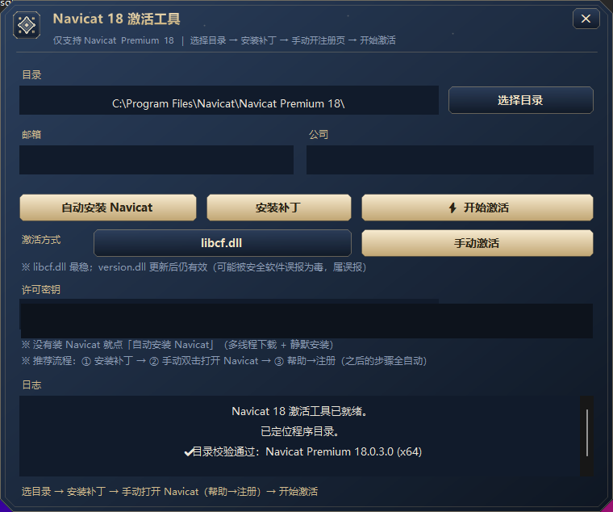
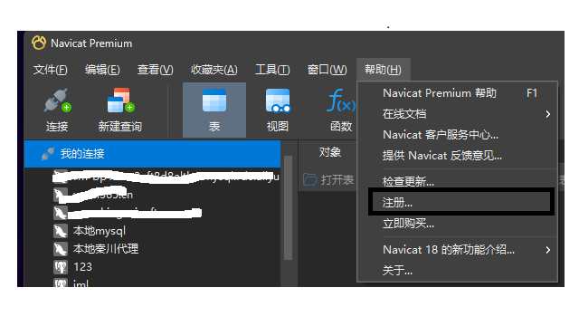
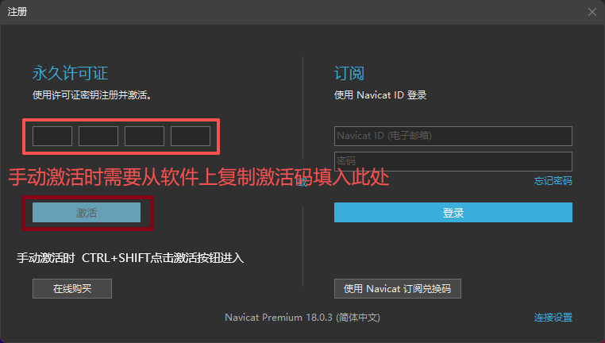

# 我给 Navicat 18 写了个离线激活工具

正版买不起，就自己写了个。不联网、不用服务器、不用卡密，源码开源。

## 用什么做的

整套东西是在 **DSH（DeepSeek Harness）** 里挂 **IG5 逆向工作台**做出来的：Ghidra 反编译、函数定位、字节级比对、改补丁、重编译、打包发版，全在同一个会话里完成。

以前得在 IDA、十六进制编辑器、终端之间来回倒，现在描述一句需求，工具自己跑一轮验证再把结果拿回来——省下来的时间基本都花在判断"这个结论对不对"上，而不是搬数据。确实好用。

## 激活路径

Navicat 手动激活走 RSA 签名：请求码用内置公钥加密，激活码用内置模数验签。验签用的是厂商模数，我签的东西它不认。

所以把两把钥匙都换了：

- `navicat.exe` 里的请求码公钥是明文 PEM，同长度覆盖成我的；
- `libcf.dll` 的验签模数不在文件里，只能对目标函数做 **inline hook（内联钩子）**——新增 `.pmod` 节，把函数前 21 字节改成 `E9`（jmp rel32）跳到 `.pmod`，跳板里换掉模数、执行原指令再跳回来。

换完，它验的就是我自己签的激活码。



## 两种补丁方式

- **libcf.dll（文件级）**：改 `libcf.dll` 和 `navicat.exe`，重启有效；官方更新会覆盖。
- **version.dll（代理 DLL）**：往 Navicat 目录放一个代理 DLL，启动时被加载、在进程内打补丁；不改 Navicat 原文件。

两种互斥——文件级补丁占了函数入口，代理 DLL 再装会报「没找到函数序言」。切换前先卸载。

## 怎么用

先构建（仓库不附带成品 exe）：

```bat
python tools\gen_keys.py
python tools\gen_payload.py
python tools\gen_offline.py
build\build_offline.cmd
```

然后：管理员运行 → 选补丁方式 → 安装补丁 → 自己双击打开 Navicat（工具启动的不行）→ 帮助 → 注册 → 回工具点开始激活。





## 几个坑

1. 代理 DLL 别手动删。删了下次启动 Navicat 就没补丁，会变回未激活。
2. 卸载会把 `.orig` 备份拷回去删掉。想留退路，装之前自己复制一份 `navicat.exe` 和 `libcf.dll`。
3. 杀软会误报，改 DLL、跨进程写内存，行为上确实像。
4. 21 字节序言是版本相关的，换大版本要重新定位（`src/pdata.cs` 的 `_pro`）。

## 地址

- Gitee：`https://gitee.com/mzy666666/navicat18-offline-activator`
- GitHub：`https://github.com/ma15803216102/navicat18-offline-activator`
